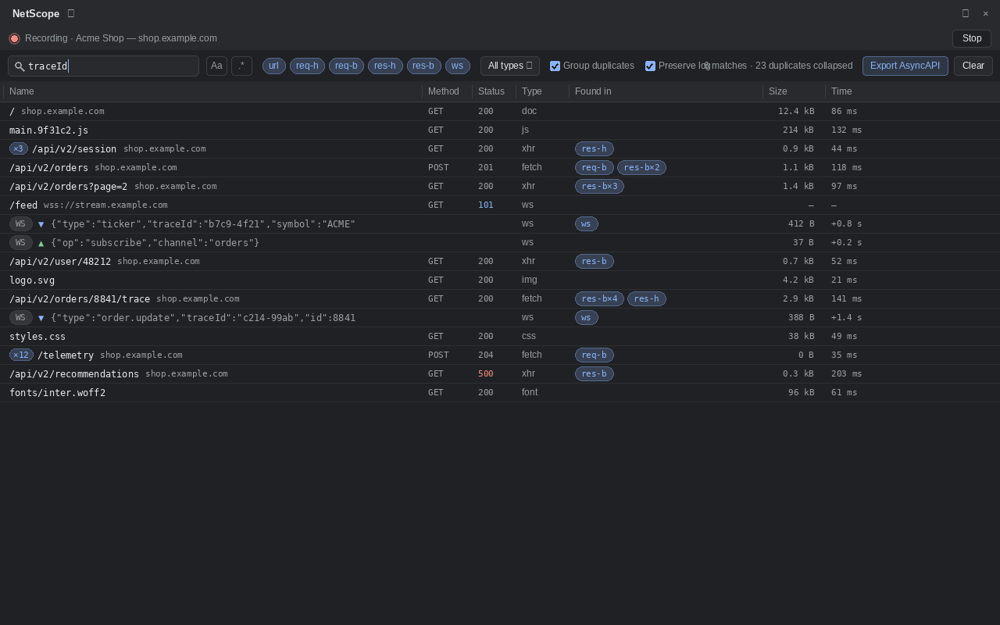
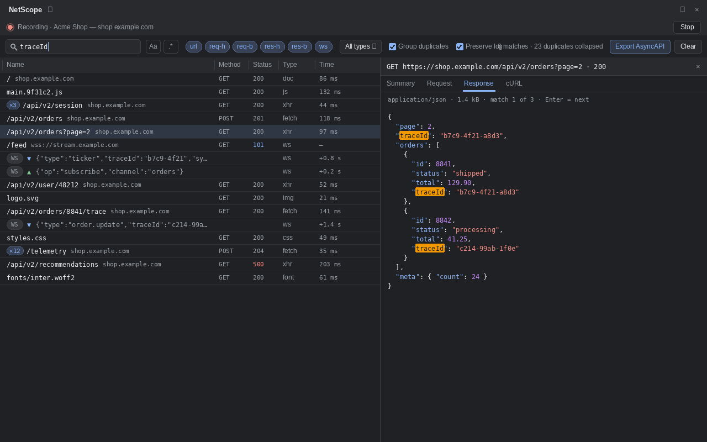
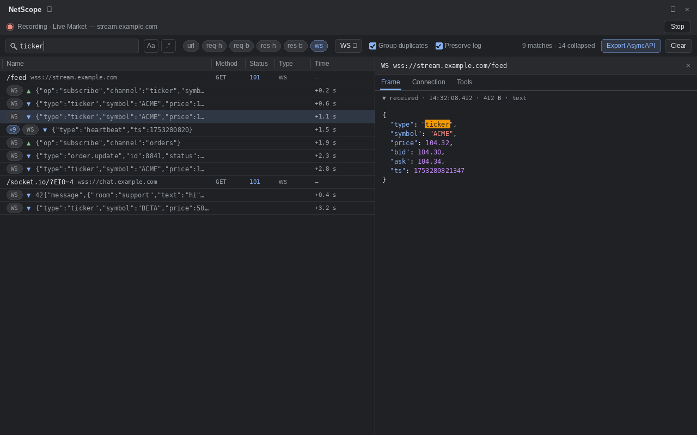

# NetScope — search Network responses & WebSockets from DevTools

Chrome's Network panel only filters by URL. NetScope is a native DevTools panel
that indexes everything the page transfers and lets you search inside it:

- **Response bodies** — find which request actually returned `"userId":48212` or an error string.
- **Request bodies & headers** — both directions, both header sets.
- **Live WebSocket frames** — every sent/received frame is captured and searchable, per direction.
- **Duplicates grouped by default** — requests with the same input (method + URL + request body)
  and identical WS frames collapse into one row with a ×N badge. Responses may differ across a
  group (polling, retries); mixed statuses get a warning-tinted badge and a per-status breakdown
  in the detail pane. Untick "Group duplicates" to see every occurrence.
- **Duplicate grouping (on by default)** — repeat polls, retries and identical
  heartbeat frames collapse into a single row with a `×N` count instead of
  flooding the list.
- **Copy as cURL** — replay any captured HTTP request 1:1 (headers and body included).
- **WS tooling** — one-click `websocat` / `wscat` commands and a cURL handshake probe per socket.
- **Export AsyncAPI 3.0** — turn the captured WebSocket traffic into an AsyncAPI skeleton
  (servers, channels, send/receive operations, real captured payloads as message examples).

Search supports plain text or regex, case toggle, per-field scopes
(`url · req-h · req-b · res-h · res-b · ws`), a resource-type filter, and "Found in" chips
showing exactly where each hit lives. `Enter` jumps to the next match; matches are
highlighted in the detail pane. `Preserve log` keeps entries across navigations.

## Duplicate grouping

Two entries are considered the same only when **everything** that defines them
matches:

- HTTP — method, full URL, status, request body, and response body (binary
  bodies compare by size). Requests whose body is still downloading are never
  grouped, so a response that turns out to differ can't be hidden.
- WebSocket — socket URL, direction, and the exact frame payload.

The kept row is the **first** occurrence, badged `×N`; opening it shows the
count with first and last timestamps and an **Ungroup** button. Untick
**Group duplicates** in the toolbar to see every entry individually. Grouping is
applied after filtering, so the match count always equals the number of rows
you can actually step through with `Enter`.

## Screenshots





## Install (unpacked)

```
git clone https://github.com/taishi55/NetScope.git
```

1. Open `chrome://extensions`
2. Enable **Developer mode** (top right)
3. **Load unpacked** → select the cloned `NetScope` folder
4. Open DevTools on any page (`F12`) → pick the **NetScope** tab (it may hide behind `»`)
5. **Reload the page once** so the WebSocket hook is in place before the app connects

## How it works

```
page (MAIN world)        isolated world        service worker         DevTools
ws-hook.js  ──postMessage──▶ ws-bridge.js ──sendMessage──▶ background.js ──port──▶ devtools.js ──▶ panel
   │                                                                        ▲
   └─ wraps window.WebSocket (send + message)                               │
                                                                            │
chrome.devtools.network.onRequestFinished + getContent  (HTTP + bodies) ────┘
```

- `devtools.js` runs for the whole DevTools session, so HTTP capture starts the moment
  DevTools opens (plus a `getHAR` backfill of anything the Network panel already recorded).
- WebSocket frames are mirrored by a tiny `Proxy` around `window.WebSocket`; native behavior
  is untouched. The background worker routes frames to the DevTools instance inspecting that
  tab and keeps a small backlog so frames fired just before the panel connects aren't lost.
- No `chrome.debugger`, so the "extension is debugging this browser" bar never appears.

## Why a DevTools panel and not a Network-panel sidebar

Chrome's extension API only allows sidebars inside the **Elements** and **Sources** panels —
there is no API to extend the Network panel itself. A dedicated DevTools panel is the closest
native integration Chrome permits, and it follows the DevTools theme (dark/light) automatically.

## Caveats

- WebSocket capture hooks `window.WebSocket` at `document_start`: pages loaded **before**
  installing/reloading the extension, and sockets opened inside **Workers**, are not seen.
- HTTP is only captured **while DevTools is open** (a Chrome platform limit, same as the HAR).
- Bodies are truncated at 1 MB and WS frames at 256 KB (constants at the top of
  `devtools.js` / `ws-hook.js`); binary bodies are flagged and skipped by search.
- Ring buffer keeps the last 4 000 entries.
- Generated cURL includes captured cookies/authorization headers verbatim — treat it as a secret.
- `<all_urls>` content-script access is required to hook WebSockets everywhere; narrow the
  `matches` patterns in `manifest.json` if you only debug specific hosts.

## Permissions

- `clipboardWrite` — the various Copy buttons.
- Content scripts on `<all_urls>` — the WebSocket hook + bridge (see note above).

## Privacy

NetScope collects nothing and transmits nothing — captured traffic lives in memory,
on your machine, for the current DevTools session only. Full policy: [PRIVACY.md](PRIVACY.md).

## License

[MIT](LICENSE)
