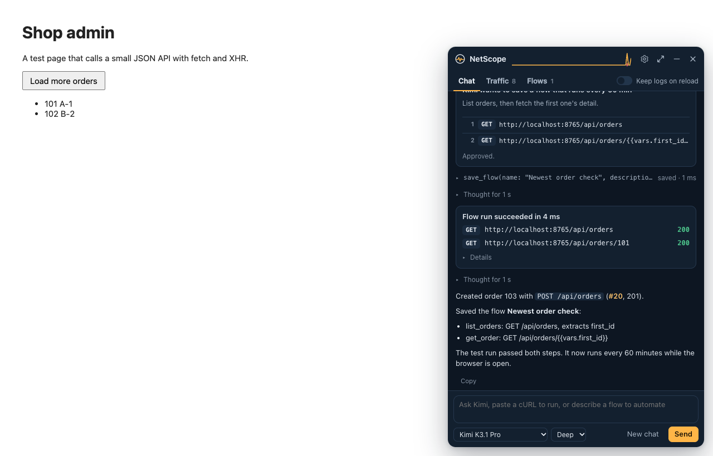
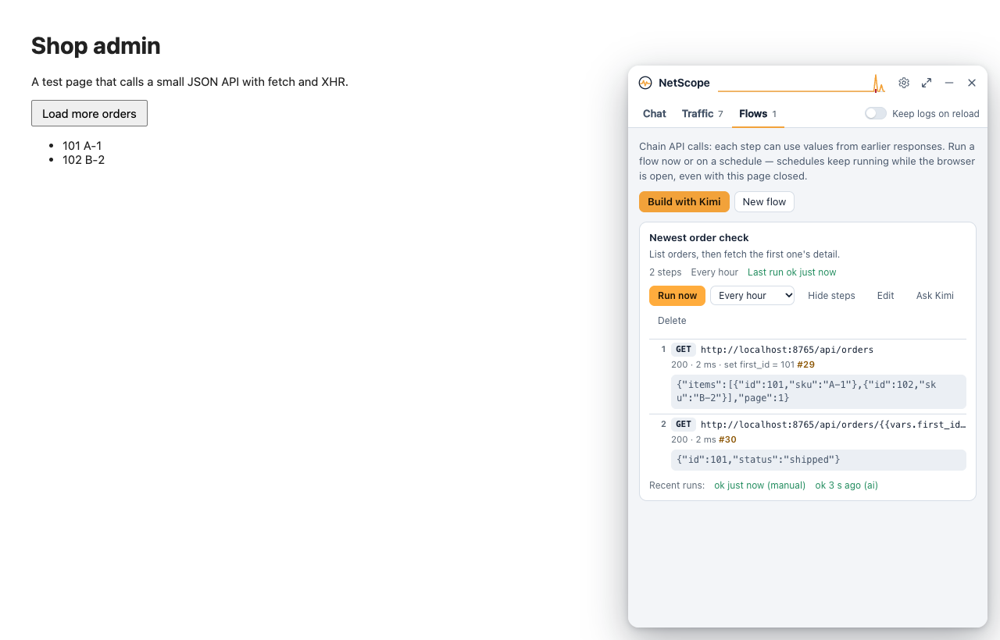
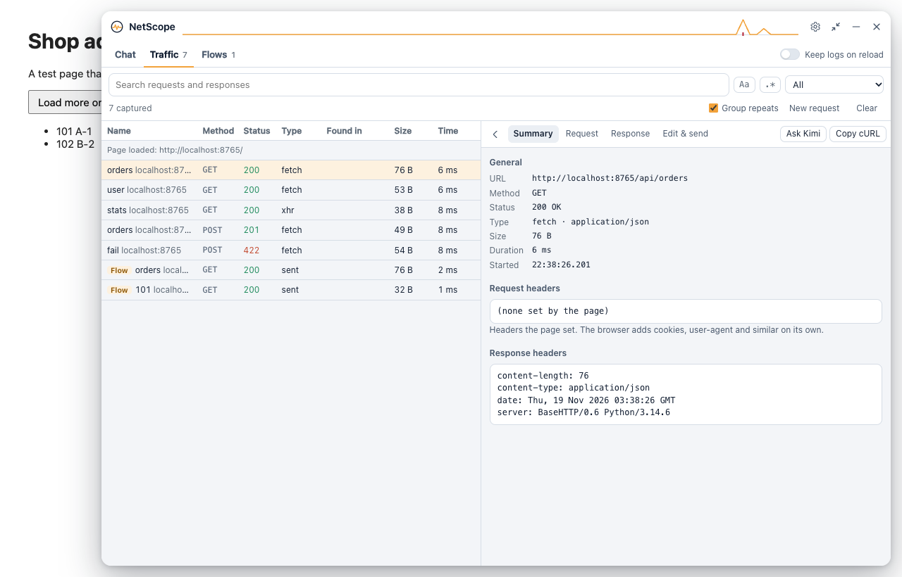

# NetScope — an AI API copilot that lives on the page

Click the NetScope icon (or press `Alt+Shift+N`) on any page and a popup opens **on the
Chat tab**. Ask Kimi about the requests the page is making, have it call endpoints for you
from a cURL, or turn a sequence of calls into a flow that runs every hour. No DevTools
needed.



- **Chat first** — the popup opens on a conversation with Kimi, grounded in the page's real
  traffic through tools (it cites requests as `#412`; click one to open it).
- **Kimi models in the dropdown** — `kimi-k3.1-pro` (default), `kimi-k3.1-pro-highspeed`,
  `kimi-k3`, plus the legacy `kimi-k2.7-code` and `kimi-k2.6`. A second dropdown sets
  thinking depth (Quick / Deep / Max → `reasoning_effort` low / high / max).
- **Call APIs like Postman** — paste a cURL into the chat, or ask Kimi to replay a captured
  request with changes. Requests run from the extension (no CORS), are logged in Traffic
  tagged *AI*, *You* or *Flow*, and anything that can change data waits for your click.
- **Flows (Zapier-style automations)** — chain requests where later steps use values from
  earlier responses (`{{steps.list_orders.body.items[0].id}}`), add conditions and AI steps,
  run on demand or on a schedule (every N minutes) in the background.
- **Keep logs on reload** — one switch in the popup header keeps the captured traffic (and
  the chat) across page reloads and navigations.
- **Traffic** — everything the old DevTools panel did, in the popup: full-text/regex search
  across URLs, headers, bodies and WebSocket frames, grouped repeats, request/response
  detail, **Edit & send** (Postman-style resend from an editable cURL), Copy cURL, and
  AsyncAPI 3.0 export for WebSocket traffic.
- **Expandable** — panel (460 px), large (near full screen, list + detail side by side), a
  pill with a live traffic trace, or hidden.

## Install (unpacked)

```
git clone https://github.com/taishi55/NetScope.git
```

1. Open `chrome://extensions`, enable **Developer mode**.
2. **Load unpacked** → select the cloned `NetScope` folder.
3. Pin the NetScope icon. On any page, click it (or press `Alt+Shift+N`).
4. Reload pages that were open before installing, so the capture hook is in place from the
   first request.

## Chat with Kimi

Open **Settings** (gear icon) → paste a key from [platform.moonshot.ai](https://platform.moonshot.ai)
→ tick the consent box → **Save and enable**. **Test key** checks the key and model access
with a free `GET /v1/models` call.

Things to try:

- “Map the API this page uses.”
- “Why did the last request fail?” — or select a request in Traffic and ask; the chip above
  the input tells Kimi which request you mean.
- Paste `curl 'https://api.example.com/v1/me' -H 'Authorization: Bearer …'` — Kimi runs it
  and explains the response.
- “Every hour, get the newest order and post its id to https://hooks.example.com/x.”

### Tools Kimi can use

| Tool | What it does |
| --- | --- |
| `get_capture_summary`, `list_endpoints`, `list_requests`, `search_traffic` | Orient in the capture, find requests |
| `get_request`, `describe_json`, `get_websocket_frames`, `compare_requests`, `get_curl` | Drill into one request or diff two |
| `http_request` | Send a request from a cURL, a captured request (`from_id`, real headers copied locally) or a URL, with overrides |
| `save_flow`, `run_flow`, `list_flows`, `get_flow`, `delete_flow` | Build, test, schedule and manage flows |

### What waits for your approval

Settings → **Ask before Kimi acts**:

- **For changes** (default) — POST/PUT/PATCH/DELETE requests, saving a flow that has a
  schedule or write steps, running a flow with write steps, deleting a flow.
- **For every request** — also GETs.
- **Never** — autopilot.

The approval card shows the exact method, URL, headers (secrets abbreviated) and body.

## Flows

A flow is an ordered list of steps. Build one by asking Kimi, or **Flows → New flow** for a
JSON editor:

```json
{
  "name": "Newest order check",
  "steps": [
    { "id": "list_orders", "method": "GET", "url": "https://shop.example.com/api/orders",
      "extract": { "first_id": "body.items[0].id" } },
    { "id": "get_order", "method": "GET", "url": "https://shop.example.com/api/orders/{{vars.first_id}}",
      "when": "{{vars.first_id}} exists", "expect_status": "2xx" },
    { "id": "summary", "type": "ai", "prompt": "One line on this order: {{steps.get_order.body | json}}" }
  ],
  "schedule": { "enabled": true, "every_minutes": 60 }
}
```

- **Step types** — `http` (`method/url/headers/body/query`, or `curl`, or Kimi's `from_id`),
  `ai` (a Kimi prompt over earlier results), `delay` (`ms`).
- **Templates** — `{{vars.x}}`, `{{steps.<id>.status}}`, `{{steps.<id>.body.<path>}}`,
  `{{steps.<id>.headers.<name>}}`, `{{now}}`, `{{now_iso}}`, `{{today}}`, `{{uuid}}`; filters
  `| json | urlencode | first | last | length | trim | upper | lower | default:x`. A JSON body
  value that is exactly one template keeps its type.
- **Per step** — `extract`, `when` (`==`, `!=`, `>`, `<`, `>=`, `<=`, `contains`,
  `!contains`, `matches`, `exists`, `missing`), `expect_status`, `continue_on_error`.
- **Schedules** run in the background worker via `chrome.alarms` while Chrome is open, even
  with the original page closed. A scheduled run that fails puts a red `!` on the toolbar
  icon and a notice in the Flows tab. The last 15 runs per flow are kept.
- **Copy as Markdown** on each flow copies the whole thing as a document: schedule, every
  step's request (with a cURL), how values pass between steps, the last run's result per
  step, and the JSON definition. Literal secrets (auth headers, cookies, token fields) are
  masked; `{{templates}}` stay as written. **Edit** still shows the raw definition.



## Traffic



Search is plain text or regex with a case toggle and per-field scopes; `Enter` jumps to the
next match. Identical requests group into one row with `×N` (a warning tint if their
statuses differ). **Edit & send** turns any request into an editable cURL you can resend;
**New request** starts from a blank one.

## How it works

```
page (MAIN world)          isolated world          service worker                  popup (iframe)
net-hook.js ─postMessage─▶ content.js ─sendMessage─▶ background.js ──port──────────▶ app.html
  wraps fetch, XHR,          hosts the popup           per-tab log (IndexedDB)          Chat · Traffic · Flows
  WebSocket                  iframe                    request runner, flows, alarms ─▶ api.moonshot.ai (your key)
```

- **Capture** — `net-hook.js` wraps `fetch`, `XMLHttpRequest` and `WebSocket` with Proxies
  at `document_start`, so native behavior and `toString()` are unchanged. Response bodies are
  read from a clone (cancelled once the cap is reached), streamed bodies update live.
- **Popup** — `content.js` injects an extension-page iframe inside a closed shadow root. The
  UI runs in the iframe, cross-origin to the page, so the page cannot read it or keylog the
  API key field.
- **Log** — the background worker owns a per-tab log, mirrored to IndexedDB so it survives
  service-worker restarts and, with **Keep logs on reload**, page reloads. Without the switch
  each new document starts a fresh log. The database is wiped when the browser starts.
- **Requests and flows** run in the background worker with the extension's host permission
  (no CORS) and the browser's own cookies for the target site.

## Caveats

- Only traffic the page's own JavaScript makes is captured (fetch, XHR, WebSocket).
  Documents, images, scripts and requests from Service/Web Workers are not.
- Request headers are the ones the page set; the browser adds cookies, user-agent and
  similar itself. Scripts cannot set `Cookie`, `Origin`, `Referer` or `User-Agent`, so a
  cURL containing them is sent without them (reported as *Not sent*) and the browser's own
  cookies for that site are used.
- Bodies and frames are captured up to 256 KB; requests NetScope sends keep up to 1 MB. Each
  tab keeps the last 3,000 entries.
- Pages where extensions cannot run (`chrome://`, the Web Store) open NetScope as a
  standalone tab instead.
- Generated cURL commands include captured auth headers verbatim — treat them as secrets.

## Permissions

- `<all_urls>` content scripts and host permission — the capture hook must be in place on
  whichever page you debug, and the request runner and flows must reach whichever API you
  point them at.
- `storage` — settings, API key, flows and run history (`chrome.storage.local`), chat per tab
  (`chrome.storage.session`). The capture log lives in the extension's IndexedDB.
- `alarms` — flow schedules.
- `scripting` — injects the capture hook into tabs that were open before installing.
- `clipboardWrite` — the Copy buttons.

## Privacy

NetScope has no analytics, telemetry or error reporting, and never contacts its developer.
Data leaves your machine only when you, or a flow you saved, ask for it: questions and
traffic excerpts go to `api.moonshot.ai` with your key, and requests you or Kimi send go to
the URLs they name. Full policy: [PRIVACY.md](PRIVACY.md).

## License

[MIT](LICENSE)
